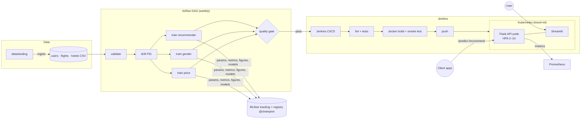

# ✈️ Voyage Analytics — Travel MLOps Capstone

An end-to-end, production-style ML system for the travel domain, built on the **users / flights / hotels** datasets. It includes:
* **Three models:** flight price regression, gender classification and hotel recommendation.
* **Serving:** a Flask REST API, packaged with Docker and scaled on Kubernetes.
* **Automation:** retraining orchestrated by Apache Airflow, releases shipped by a Jenkins CI/CD pipeline.
* **Tracking and UI:** MLflow for experiments and versioning, plus an interactive Streamlit app.

## Live demo

| | Link |
|---|---|
| **Web app** (hotel recommendations, travel insights, price and gender prediction, model monitoring) | https://pranati-voyage-analytics.onrender.com |
| **REST API** (endpoint list and examples on the home page) | https://travel-mlops.onrender.com |

Both run on Render's free plan, which sleeps when idle: the first visit can take about a minute to wake up.

```bash
curl -X POST https://travel-mlops.onrender.com/predict -H 'Content-Type: application/json' \
  -d '{"from":"Recife (PE)","to":"Florianopolis (SC)","flightType":"firstClass","agency":"FlyingDrops"}'
```

| Model | Approach | Result (held-out) |
|---|---|---|
| Flight price | Random Forest champion + Ridge fallback for unseen routes | RMSE **0.00**, R² **1.000** on future flights (time split); R² 0.88 on unseen routes (fallback) |
| Gender | TF-IDF character n-grams of first name + logistic regression, trained on users + 31k labelled names from many countries | Accuracy **93.1%**, macro F1 **0.931**; 88.6% on never-seen names, 86.8% on Indian names |
| Hotel recommendation | Hybrid (collaborative + home-city penalty), weights tuned by grid search | hit@3 **0.375** vs 0.329 random / 0.365 popularity |

* **Data exploration and modeling walkthrough:** [notebooks/travel_capstone_analysis.ipynb](notebooks/travel_capstone_analysis.ipynb)
* **Full evaluation and interpretation**, including *why* the price model is perfect and the recommender's ceiling is low:
  [reports/MODEL_EVALUATION.md](reports/MODEL_EVALUATION.md)
* **Final project report:** [docs/PROJECT_REPORT.md](docs/PROJECT_REPORT.md)

---

## Business context

Travel and tourism companies hold large amounts of data on who travels, where they go, how they fly and where
they stay. Data analytics and machine learning can turn that data into better travel experiences:
* **Fair, transparent prices**, estimated before the customer searches.
* **Better knowledge of customers**, for analytics and segmentation.
* **Relevant hotel suggestions**, which raise conversion.

A model in a notebook delivers none of this. It creates value only when it runs as a **reliable service**:
* available in real time;
* scaled with demand;
* retrained as data changes;
* versioned, so every prediction can be traced to the model that produced it.

This project therefore has two goals:
1. build accurate predictive models on travel data;
2. practise **MLOps** end to end with the industry-standard tools for each step.

## Problem statement

Using three linked datasets (users, flights and hotels), build, deploy and operate machine-learning models that:

1. **Predict the price of a flight** from its route, cabin class, agency and distance (regression).
2. **Classify a user's gender** (classification).
3. **Recommend hotels** to a user based on their preferences and booking history (recommendation).

The models must:
* be served in real time through a REST API;
* be packaged for portability and scaled under varying load;
* be retrained automatically by scheduled workflows;
* be released through a CI/CD pipeline;
* be tracked and versioned throughout their life cycle;
* be explorable by business users through an interactive web app.

## Project objectives

| # | Objective (from the brief) | How it is delivered | Guide |
|---|---|---|---|
| 1 | **Regression model**: predict flight price from `flights.csv`, with feature selection, training and validation | 4 candidates incl. a feature-selection ablation. Time-based + unseen-route validation (`src/train_flight_price.py`) | [evaluation](reports/MODEL_EVALUATION.md#2-flight-price-regression) |
| 2 | **REST API** with Flask for real-time price predictions | `/predict`, `/predict/gender`, `/recommend`, `/health`, `/metrics`, input validation (`api/app.py`) | [api/README.md](api/README.md) |
| 3 | **Containerization** with Docker | Multi-stage, non-root image with healthcheck and models baked in per tag (`Dockerfile`, `docker-compose.yml`) | [docs/DEPLOYMENT.md](docs/DEPLOYMENT.md) |
| 4 | **Kubernetes** for scalability under varying load | Rolling updates, probes, HPA 2–10 (verified 2→10 under load), PDB, Ingress (`k8s/`) | [k8s/README.md](k8s/README.md) |
| 5 | **Apache Airflow** DAGs to automate the workflow | ingest → validate → drift → 3× train (parallel) → quality gate → deploy (`airflow/dags/`) | [airflow/README.md](airflow/README.md) |
| 6 | **CI/CD with Jenkins** | lint → validate → train → test → build → smoke test → push → deploy + auto-rollback (verified, 3 min 40 s) | [jenkins/README.md](jenkins/README.md) |
| 7 | **MLflow** model tracking and versioning | 3 experiments, model registry, `@champion` alias, figures logged as artifacts (`src/tracking.py`) | [src/README.md](src/README.md#mlflow-usage) |
| 8 | **Gender classification** model | Name-based classifier served by the API, trained on users plus world names (`data/world_names.csv`). Users-only, 3-class and behaviour experiments logged (`src/train_gender.py`) | [evaluation](reports/MODEL_EVALUATION.md#3-gender-classification) |
| 9 | **Recommendation model + Streamlit** app with insights and visualisations | Hybrid recommender tuned on temporal validation. 5-tab app (`src/recommender.py`, `streamlit_app/`) | [streamlit_app/README.md](streamlit_app/README.md) |

## Datasets

Three CSV files in `data/`. The trips span 26 Sep 2019 to 24 Jul 2023.

```
users (1,340) ──code = userCode──┬── flights (271,888 legs = 135,944 round trips)
                                 └── hotels  (40,552 stays)
              flights ──travelCode── hotels   (a hotel stay belongs to a trip)
```

**`users.csv`**: one row per user. Used for the gender model and user profiles.

| Field | Type | Description | Example |
|---|---|---|---|
| `code` | int | User identifier (primary key) | `0` |
| `company` | text | Company the user is associated with (5 companies) | `4You` |
| `name` | text | User's full name | `Roy Braun` |
| `gender` | text | `male`, `female` or `none` (not disclosed) | `male` |
| `age` | int | Age in years (21–65) | `21` |

**`flights.csv`**: one row per flight leg. Each round trip has an outbound and a return leg sharing a `travelCode`.
Used for the price model and to find each user's home city.

| Field | Type | Description | Example |
|---|---|---|---|
| `travelCode` | int | Trip identifier (shared by both legs; links to hotels) | `0` |
| `userCode` | int | User who travelled (→ `users.code`) | `0` |
| `from` | text | Origin city (9 Brazilian cities) | `Recife (PE)` |
| `to` | text | Destination city | `Florianopolis (SC)` |
| `flightType` | text | Cabin class: `economic`, `premium`, `firstClass` | `firstClass` |
| `price` | float | Ticket price in R$ (**target** of the regression) | `1434.38` |
| `time` | float | Flight duration in hours | `1.76` |
| `distance` | float | Distance in km | `676.53` |
| `agency` | text | Booking agency: `CloudFy`, `FlyingDrops`, `Rainbow` | `FlyingDrops` |
| `date` | date | Flight date (MM/DD/YYYY) | `09/26/2019` |

**`hotels.csv`**: one row per hotel stay. Used for the recommender.

| Field | Type | Description | Example |
|---|---|---|---|
| `travelCode` | int | Trip the stay belongs to (→ `flights.travelCode`) | `0` |
| `userCode` | int | User who stayed (→ `users.code`) | `0` |
| `name` | text | Hotel name (9 hotels, one per city) | `Hotel A` |
| `place` | text | Hotel city, always the trip's destination | `Florianopolis (SC)` |
| `days` | int | Number of nights (1–4) | `4` |
| `price` | float | Price per night in R$ | `313.02` |
| `total` | float | Total cost of the stay (`price × days`) | `1252.08` |
| `date` | date | Check-in date (MM/DD/YYYY) | `09/26/2019` |

**Which data serves which use case**
* **Flight price:** `flights` (route, class, agency, distance → price).
* **Gender:** `users` (name → gender).
* **Recommendation:** `hotels` (booking history), `flights` (home city from outbound legs) and `users` (profiles).

---

## Architecture



## Repository structure

```
travel-mlops/
├── data/                     users.csv · flights.csv · hotels.csv (capstone dataset)
├── notebooks/                EDA + modeling walkthrough (executed, renders on GitHub)
├── src/                      data, training, MLflow tracking, recommender, monitoring   → src/README.md
├── api/                      Flask REST API + gunicorn config                           → api/README.md
├── streamlit_app/            Streamlit web app                                          → streamlit_app/README.md
├── airflow/dags/             orchestration DAG                                          → airflow/README.md
├── k8s/                      Deployment, Service, HPA, PDB, Ingress, Kustomize          → k8s/README.md
├── jenkins/                  local Jenkins image + config-as-code (job, credentials)    → jenkins/README.md
├── Dockerfile, Dockerfile.streamlit, docker-compose.yml, Jenkinsfile                    → docs/DEPLOYMENT.md
├── tests/                    24 pytest tests (API contract, recommender, data, drift)
├── reports/                  MODEL_EVALUATION.md, figures/, drift_report.json
├── docs/                     PROJECT_REPORT.md, DEPLOYMENT.md
├── scripts/generate_data.py  synthetic data with the same schema (demo only)
└── Makefile                  one-line commands for everything below
```

## Quick start

Requirements: Python 3.12+. For the container parts: `brew install colima docker docker-buildx kubectl`, then
`make colima-up` (Docker + Kubernetes in one VM). minikube or Docker Desktop also work.

```bash
git clone <this-repo> && cd travel-mlops
make setup        # .venv + dependencies
make train        # validate → drift check → train 3 models → MLflow (~2 min)
make test         # 25 tests
make api          # REST API      → http://localhost:8000
make ui           # Streamlit     → http://localhost:8501
make mlflow-ui    # MLflow        → http://localhost:5001
```

Containers, Kubernetes and CI/CD (all verified end to end on Colima):

```bash
make colima-up && make k8s-deploy && make k8s-forward     # Kubernetes: API :8000, Streamlit :8501
make jenkins-up && make jenkins-build                       # Jenkins pipeline → http://localhost:8080
```

**VS Code:** open the folder, select the `.venv` interpreter, and use **Run and Debug** → *Flask API* / *Streamlit app* /
*Train all models*. Tests appear in the Testing panel.

## Deploying to Render

Trained models aren't committed, so both Render images train them during the build (about 5 minutes on the free plan).
Create a **Web Service** per app from this repository with language **Docker**, branch `main`, and:

| Service | Dockerfile Path | Health Check Path |
|---|---|---|
| REST API | `./Dockerfile.render` | `/health` |
| Streamlit app | `./Dockerfile.streamlit.render` | `/_stcore/health` |

No environment variables are needed: Render sets `PORT` and both images read it. Connect the repository through
**Git Provider → GitHub** (not the public URL) so that pushes to `main` deploy automatically. The builds cap training at
2 workers, because build machines report far more CPU cores than they actually give the build.

## Usage

**Predict a flight price** (API running via `make api` or `make k8s-forward`):
```bash
curl -X POST localhost:8000/predict -H 'Content-Type: application/json' \
  -d '{"from":"Recife (PE)","to":"Florianopolis (SC)","flightType":"firstClass","agency":"FlyingDrops"}'
# {"model_version":1,"predictions":{"known_route":true,"model":"random_forest","predicted_price":1434.38}}
```

**Classify gender / get hotel recommendations:**
```bash
curl -X POST localhost:8000/predict/gender -H 'Content-Type: application/json' -d '{"name":"Patricia Carson"}'
curl "localhost:8000/recommend/0?k=3&max_price=250"
```

**Explore in the web app:** `make ui` → http://localhost:8501. Pick a traveller to see recommended hotels, browse
travel insights, try the price estimator and the gender classifier, and check model monitoring.

**Compare experiments and model versions:** `make mlflow-ui` → http://localhost:5001. Open the
*travel-flight-price* experiment to compare the candidate runs, and *Models* to see versions and the `@champion` alias.

**Retrain on new data:** drop new CSVs into `data/landing/` and trigger the Airflow DAG `travel_ml_pipeline`
([airflow/README.md](airflow/README.md)), or run `make train` locally.

**Release a change:** commit, then `make jenkins-build`. Jenkins tests, builds and deploys it to Kubernetes
([jenkins/README.md](jenkins/README.md)).

**Check for data drift:** `make monitor` writes `reports/drift_report.json` (PSI per feature).

## Key findings

* **The price is a deterministic lookup** over (route, class, agency). `time` duplicates `distance` and dates have no effect,
  so the selected features are `from`, `to`, `flightType`, `agency`, `distance`.
* **Trees memorise routes and Ridge generalises.** That's why the API automatically falls back to Ridge for unseen routes.
* **Gender "none" (one third of users) means "not disclosed"** and isn't predictable, so the served model is male/female from the first name.
* **The gender API says "uncertain" instead of guessing** when the first name is not in a worldwide list of
  ~34k first names (so "abc" or "axhy" get no gender) or when the model's confidence is below 0.60.
  Digits, symbols or a one-letter name return HTTP 400. Cutoff chosen from data: [evaluation §3.1](reports/MODEL_EVALUATION.md#31-abstaining-with-uncertain-non-names-and-close-calls).
* **Destinations are almost uniformly random**, which puts a ceiling on recommendation quality. The pipeline reports lift
  over random and popularity baselines instead of claiming headline accuracy.

## Configuration

| Env var | Default |
|---|---|
| `DATA_DIR`, `MODEL_DIR`, `REPORTS_DIR` | `./data`, `./models`, `./reports` |
| `MLFLOW_TRACKING_URI` | `sqlite:///mlflow.db` |
| `MIN_FLIGHT_R2` / `MIN_GENDER_F1` | `0.90` / `0.80` |
| `PSI_ALERT` | `0.2` |
| `API_URL` (Streamlit) | unset = use local model files |

## Documentation
* [EDA & modeling notebook](notebooks/travel_capstone_analysis.ipynb): data understanding, feature selection, model training and validation, with charts
* [Project report](docs/PROJECT_REPORT.md): problem, data, design, results, challenges, future work
* [Model evaluation](reports/MODEL_EVALUATION.md): metrics, figures, interpretation
