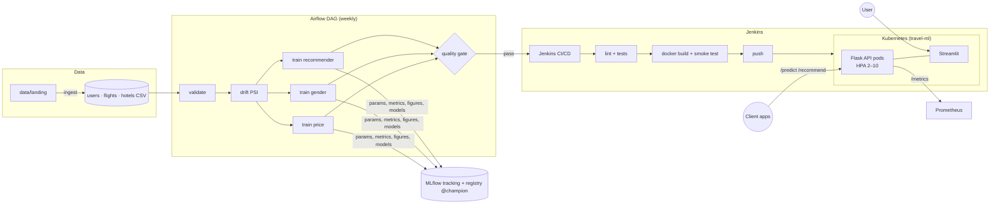

# ✈️ Voyage Analytics — Travel MLOps Capstone

An end-to-end, production-style ML system for the travel domain, built on the **users / flights / hotels** datasets. It includes:
* **Three models:** flight price regression, gender classification and hotel recommendation.
* **Serving:** a Flask REST API, packaged with Docker and scaled on Kubernetes.
* **Automation:** retraining orchestrated by Apache Airflow, releases shipped by a Jenkins CI/CD pipeline.
* **Tracking and UI:** MLflow for experiments and versioning, plus an interactive Streamlit app.

| Model | Approach | Result (held-out) |
|---|---|---|
| Flight price | Random Forest champion + Ridge fallback for unseen routes | RMSE **0.00**, R² **1.000** on future flights (time split); R² 0.88 on unseen routes (fallback) |
| Gender | TF-IDF character n-grams of first name + logistic regression | Accuracy **89.4%**, macro F1 **0.894**; 76% on never-seen names |
| Hotel recommendation | Hybrid (collaborative + home-city penalty), weights tuned by grid search | hit@3 **0.375** vs 0.329 random / 0.365 popularity |

➡️ The full analysis, including *why* the price model is perfect and the recommender's ceiling is low, is in
**[reports/MODEL_EVALUATION.md](reports/MODEL_EVALUATION.md)**.

---

## Architecture



## Repository structure

```
travel-mlops/
├── data/                     users.csv · flights.csv · hotels.csv (capstone dataset)
├── src/                      data, training, MLflow tracking, recommender, monitoring   → src/README.md
├── api/                      Flask REST API + gunicorn config                           → api/README.md
├── streamlit_app/            Streamlit web app                                          → streamlit_app/README.md
├── airflow/dags/             orchestration DAG                                          → airflow/README.md
├── k8s/                      Deployment, Service, HPA, PDB, Ingress, Kustomize          → k8s/README.md
├── jenkins/                  local Jenkins image + config-as-code (job, credentials)    → jenkins/README.md
├── Dockerfile, Dockerfile.streamlit, docker-compose.yml, Jenkinsfile                    → docs/DEPLOYMENT.md
├── tests/                    24 pytest tests (API contract, recommender, data, drift)
├── reports/                  MODEL_EVALUATION.md, figures/, drift_report.json
├── docs/                     PROJECT_REPORT.md, DEPLOYMENT.md
├── scripts/generate_data.py  synthetic data with the same schema (demo only)
└── Makefile                  one-line commands for everything below
```

## Quick start

Requirements: Python 3.12+. For the container parts: `brew install colima docker docker-buildx kubectl`, then
`make colima-up` (Docker + Kubernetes in one VM). minikube or Docker Desktop also work.

```bash
git clone <this-repo> && cd travel-mlops
make setup        # .venv + dependencies
make train        # validate → drift check → train 3 models → MLflow (~2 min)
make test         # 24 tests
make api          # REST API      → http://localhost:8000
make ui           # Streamlit     → http://localhost:8501
make mlflow-ui    # MLflow        → http://localhost:5001
```

Containers, Kubernetes and CI/CD (all verified end to end on Colima):

```bash
make colima-up && make k8s-deploy && make k8s-forward     # Kubernetes: API :8000, Streamlit :8501
make jenkins-up && make jenkins-build                       # Jenkins pipeline → http://localhost:8080
```

**VS Code:** open the folder, select the `.venv` interpreter, and use **Run and Debug** → *Flask API* / *Streamlit app* /
*Train all models*. Tests appear in the Testing panel.

## Components

| # | Objective | Implementation | Guide |
|---|---|---|---|
| 1 | Flight price regression | Time-based + unseen-route evaluation, 4 candidates incl. feature ablation | [reports](reports/MODEL_EVALUATION.md#2-flight-price-regression) |
| 2 | REST API | `/predict`, `/predict/gender`, `/recommend`, `/health`, `/metrics`, input validation | [api/README.md](api/README.md) |
| 3 | Docker | Multi-stage, non-root, healthcheck, models baked in per tag | [docs/DEPLOYMENT.md](docs/DEPLOYMENT.md) |
| 4 | Kubernetes | Rolling updates, probes, HPA 2–10 (verified 2→10 under load), PDB, Ingress | [k8s/README.md](k8s/README.md) |
| 5 | Airflow | ingest → validate → drift → 3× train (parallel) → gate → deploy | [airflow/README.md](airflow/README.md) |
| 6 | Jenkins | lint → validate → train → test → build → smoke → push → deploy + auto-rollback (verified, 3 min 40 s) | [jenkins/README.md](jenkins/README.md) |
| 7 | MLflow | 3 experiments, model registry, `@champion` alias, figures as artifacts | [src/README.md](src/README.md#mlflow-usage) |
| 8 | Gender classifier | Binary name model; 3-class and behaviour experiments logged | [reports](reports/MODEL_EVALUATION.md#3-gender-classification) |
| 9 | Recommender + Streamlit | Hybrid recommender, 5-tab app with insights and monitoring | [streamlit_app/README.md](streamlit_app/README.md) |

## Example

```bash
curl -X POST localhost:8000/predict -H 'Content-Type: application/json' \
  -d '{"from":"Recife (PE)","to":"Florianopolis (SC)","flightType":"firstClass","agency":"FlyingDrops"}'
# {"model_version":1,"predictions":{"known_route":true,"model":"random_forest","predicted_price":1434.38}}
```

## Key findings

* **The price is a deterministic lookup** over (route, class, agency). `time` duplicates `distance` and dates have no effect,
  so the selected features are `from`, `to`, `flightType`, `agency`, `distance`.
* **Trees memorise routes and Ridge generalises.** That's why the API automatically falls back to Ridge for unseen routes.
* **Gender "none" (one third of users) means "not disclosed"** and isn't predictable, so the served model is male/female from the first name.
* **Destinations are almost uniformly random**, which puts a ceiling on recommendation quality. The pipeline reports lift
  over random and popularity baselines instead of claiming headline accuracy.

## Configuration

| Env var | Default |
|---|---|
| `DATA_DIR`, `MODEL_DIR`, `REPORTS_DIR` | `./data`, `./models`, `./reports` |
| `MLFLOW_TRACKING_URI` | `sqlite:///mlflow.db` |
| `MIN_FLIGHT_R2` / `MIN_GENDER_F1` | `0.90` / `0.80` |
| `PSI_ALERT` | `0.2` |
| `API_URL` (Streamlit) | unset = use local model files |

## Documentation
* [Project report](docs/PROJECT_REPORT.md): problem, data, design, results, challenges, future work
* [Model evaluation](reports/MODEL_EVALUATION.md): metrics, figures, interpretation
