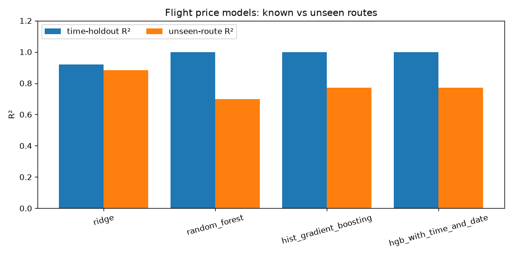
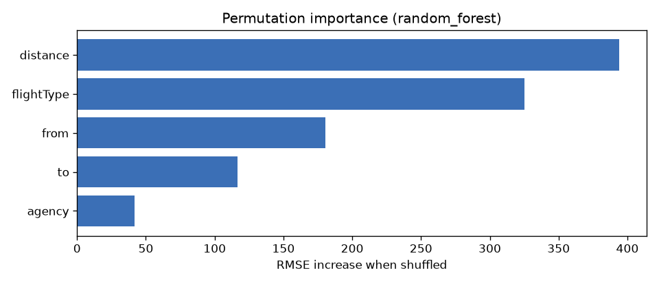
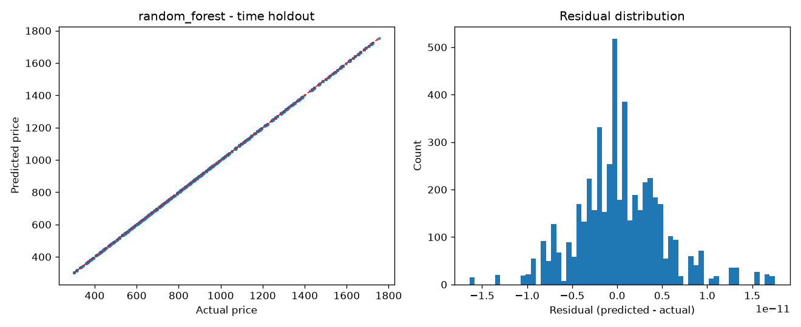
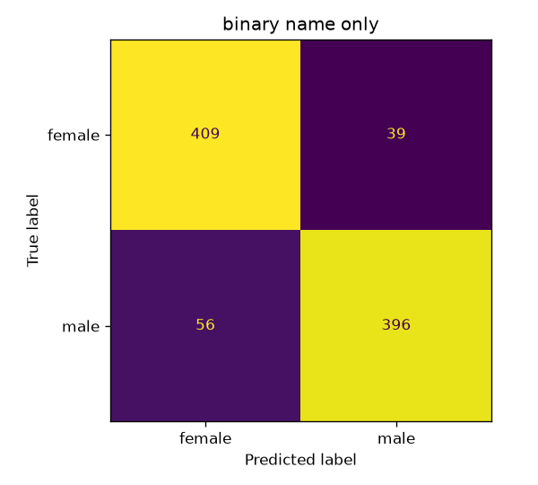
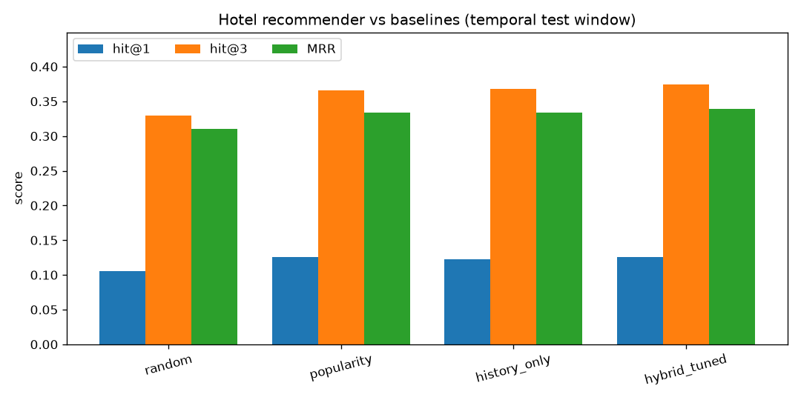

# Model Evaluation & Analysis

All numbers in this report come from `make train` on the full capstone dataset
(1,340 users · 271,888 flight legs / 135,944 round trips · 40,552 hotel stays).
Every number is logged in MLflow (`make mlflow-ui`) and in `models/metrics/*.json`.
The figures are in `reports/figures/`.

---

## 1. What the data tells us before modelling

| Finding | Evidence | Consequence |
|---|---|---|
| Flights are **round trips**. The outbound and return legs share a `travelCode`. | Every `travelCode` appears exactly twice. | Destination preferences use the outbound leg only (`src/data.py: outbound_legs`). |
| Flight **price is a deterministic function** of (from, to, flightType, agency). | Standard deviation of price within each of the 490 groups = **0.00**. | A tree model can reach R² ≈ 1.0 on known routes, so a random split proves little. We add an **unseen-route** test. |
| `time` and `distance` carry the same information. | Pearson r = **1.000**, and each route has exactly one distance. | `time` is dropped. Feature selection is confirmed by an ablation run. |
| Prices have **no time effect**. | Time-based and random splits give the same R² for every model. | Calendar features are dropped. Confirmed by the same ablation run. |
| Class and agency drive price. | Mean price: economic R$658 · premium R$920 · firstClass R$1,181. FlyingDrops is ~29% more expensive than CloudFy/Rainbow. | Both are kept as categorical features. |
| **One hotel per city** (9 hotels), each with one fixed nightly price. | 9 hotel names, 9 places, 9 (name, place) pairs. Price std = 0. | Recommending a hotel is the same as recommending a destination. |
| **Destinations are close to uniformly random.** | For every origin, each other city gets 12–13% of trips. A gradient-boosting classifier using origin, month, weekday, age, company, gender, class and agency reaches 12.3% accuracy, against 12.5% for a uniform guess. | Personalisation can only give a modest lift. The recommender is judged against random and popularity baselines. |
| Gender `none` is **one third** of users (440 of 1,340). These users have ordinary gendered names (e.g. "Debbie Helms", "Jack Sabo"). | Name-based 3-class accuracy is only 54%. | `none` means "not disclosed". The served model predicts male/female only. |
| Trip volume **declines steadily** from 2019 to 2023. | Trips per month (Streamlit → Travel insights). | The time-based test set (newest 20% of flights) is smaller. Drift is watched with PSI. |

---

## 2. Flight price regression

**Protocol.**
- **Primary test (time-based holdout):** train on flights before 2021-11-25 (80%, 217,230 rows) and test on the newest 20% (54,658 rows). This mirrors production, where the model predicts future bookings.
- **Robustness test (unseen routes):** 5-fold `GroupKFold` on undirected routes, so every route in the test fold is missing from training.

| Model | Features | RMSE | MAE | R² | MAPE | Unseen-route R² | Unseen-route MAE |
|---|---|---|---|---|---|---|---|
| Ridge | selected | 102.16 | 80.40 | 0.921 | 10.2% | **0.882** | **97.3** |
| **Random Forest** ✅ | selected | **0.00** | **0.00** | **1.000** | **0.0%** | 0.698 | 154.8 |
| HistGradientBoosting | selected | 3.39 | 2.49 | 1.000 | 0.31% | 0.770 | 134.2 |
| HGB + `time` + date features (ablation) | all | 3.33 | 2.47 | 1.000 | 0.30% | 0.771 | 134.1 |

*Selected features: `from`, `to`, `flightType`, `agency`, `distance`.*

**Interpretation**
* **Random Forest reproduces every known price exactly.** Because the price is a lookup over
  490 (route × class × agency) combinations, a forest with enough depth memorises each
  one. This is correct behaviour for this data, not leakage: the test rows are *later in time*
  than the training rows.
* **Feature selection is justified by the ablation.** Adding `time` and four calendar features changes
  RMSE by 0.06 (3.39 → 3.33) and unseen-route R² by 0.001.
* **Tree models generalise worse to new routes.** Ridge learns additive city effects plus a distance
  slope, so it extrapolates to new routes (R² 0.88). The trees memorise route identity (0.70–0.77).
  **Design decision:** the API serves the Random Forest for known routes and switches
  automatically to the Ridge fallback when a route was never seen in training. The response reports which
  one was used (`known_route`, `model`).
* **Permutation importance** (RMSE increase when a feature is shuffled): distance 394 · flightType 325 ·
  from 181 · to 117 · agency 42. This matches the business intuition: distance and cabin class set the price.

**Quality gate:** time-holdout R² ≥ 0.90 (`MIN_FLIGHT_R2`). Passed.

---

## 3. Gender classification

**Protocol.**
- **Stratified 5-fold cross-validation**, reporting accuracy and macro precision, recall and F1.
- **Unseen names:** `GroupKFold` grouped by first name, so the model is tested only on first names it has never seen.

| Experiment | Labels | Accuracy | Macro F1 | Unseen-names accuracy |
|---|---|---|---|---|
| Name only | female / male / none | 0.543 | 0.530 | 0.477 |
| Name + age, company, travel behaviour | female / male | 0.900 | 0.900 | 0.753 |
| **Name only** ✅ (served) | female / male | **0.894** | **0.894** | **0.764** |

Per class (served model): female precision 0.88 / recall 0.91 · male precision 0.91 / recall 0.88.

**Interpretation**
* **`none` cannot be predicted.** Adding it as a third class drops accuracy from 89% to 54%, and the
  3-class confusion matrix shows `none` spread across all predictions. Those users simply did not disclose a
  gender.
* **Behavioural features add nothing reliable.** They gain +0.6 points on regular CV but lose 1.1 points
  on unseen names, and the averages per gender are almost identical (age 42.3–43.2, first-class share 42–43%).
  Following Occam's razor, we serve the simpler name-only model.
* **The model generalises to new names** at 76% accuracy. It learns sub-word patterns (e.g. names
  ending in *-a*, *-ine*) through character 2–4-grams.
* **Ethics note.** Inferring gender from a name is unreliable and gender is not binary. The API response says so,
  and the prediction should never drive decisions about individuals.

**Quality gate:** macro F1 ≥ 0.80 (`MIN_GENDER_F1`). Passed.

---

## 4. Hotel recommendation

**Protocol.** Per-user temporal split for users with at least 5 stays:
- Weights are **tuned** by fitting on the first 60% of each user's stays and validating on the next 20%.
- Results are **reported** by fitting on the first 80% and testing on the last 20% (7,607 held-out stays).

The test window is never seen during tuning. A grid search over 105 weight combinations optimises MRR.
Ties are broken randomly, so sparse signals cannot score hits from tied zeros.

| Ranking | hit@1 | hit@3 | MRR | NDCG@3 |
|---|---|---|---|---|
| Random | 0.105 | 0.329 | 0.310 | 0.232 |
| Global popularity | 0.126 | 0.365 | 0.333 | 0.261 |
| User history only | 0.123 | 0.367 | 0.333 | 0.261 |
| **Hybrid (tuned)** ✅ | **0.126** | **0.375** | **0.339** | **0.266** |

The tuned weights are collaborative similarity 0.5 and home-city penalty 3.0. History, popularity and budget all get weight 0.

**Interpretation**
* With 9 hotels, a random ranking already gets hit@3 = 3/9 ≈ 0.33. The tuned hybrid adds **+4.6 points
  hit@3 (+14% relative)** over random, and beats popularity and history-only on every metric.
* The **home-city penalty** is the strongest signal: people rarely book a hotel in the city they fly
  out of. Item-item collaborative similarity adds a small further gain.
* The gain is modest because, as section 1 shows, **the data contains almost no destination preference
  signal**. A model cannot beat the information in the data. On real booking data, the same pipeline (signals →
  weight grid search → temporal validation) would automatically give more weight to history and budget.

---

## 5. Monitoring

* `src/monitor.py` computes the **Population Stability Index** (PSI) between the training history and the last 90 days
  for price, distance, flightType, agency, from and to. The latest run shows every PSI below 0.04, so there is no drift.
  The alert threshold is 0.2.
* Airflow runs this check on every retraining (`check_drift`), and Streamlit plots it (Model monitoring tab).
* The API exposes `/metrics` in Prometheus format. It reports request counts and latency per endpoint, known-route vs fallback
  predictions, the mean predicted price (to spot output drift), and cold-start vs known-user recommendations.

## 6. Limitations & next steps

* The dataset is synthetic: prices are deterministic and destinations random. The flight model's perfect
  score would not hold on real fares. Real fares would need demand, seasonality and lead-time features.
* There is no user feedback loop. Click and booking logs would allow online evaluation (A/B tests) of the recommender.
* A gender model trained only on names inherits cultural bias in naming conventions.
